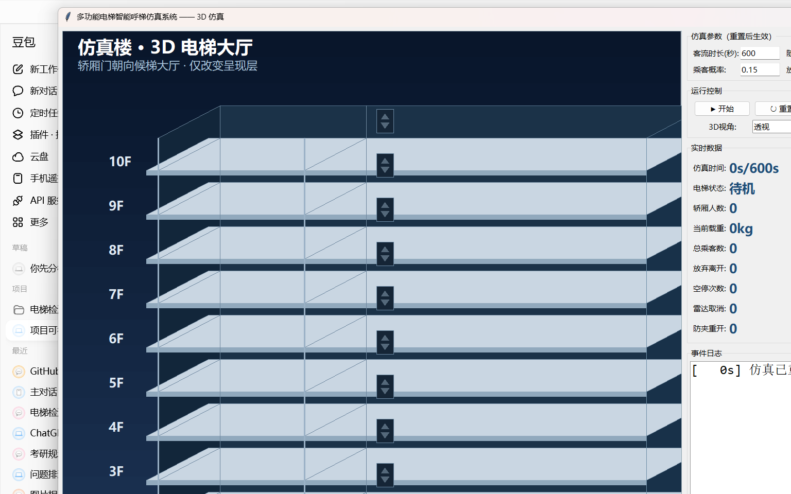

# 多功能电梯智能呼梯仿真系统

> ## ⚠️ 免责声明（请务必阅读）
> 本项目是**纯软件仿真与教学研究项目**，所有雷达监测、负重检测、防夹保护等功能均由代码逻辑模拟，**不涉及任何真实电梯硬件改造，不接入、不控制任何真实电梯设备**。
>
> 电梯属于特种设备，真实电梯的改造、加装、控制受到《中华人民共和国特种设备安全法》等法律法规严格限制，必须由具备资质的单位实施。**严禁将本项目任何代码、方案直接或间接用于真实电梯设备。** 因不当使用造成的一切后果由使用者自行承担。

## 一、项目解决什么问题

传统电梯运行中存在三类典型浪费与安全隐患：

1. **无效空停**：乘客按了呼梯后临时离开，电梯仍白跑一趟开门，浪费运力与能耗；
2. **超载运行**：轿厢满载后仍有乘客挤入，存在安全隐患且影响运行效率；
3. **关门夹人**：乘客晚到或走向电梯时门已关闭，容易发生夹人事故。

本项目用纯软件离散事件仿真，模拟一台10层电梯的完整运行，并叠加**毫米波雷达无人呼梯取消、轿厢负重超载控制、关门防夹行人重开**三项智能化功能，通过对照实验量化它们对电梯效率与安全性的改善效果。

## 二、主要功能

| 功能模块 | 说明 |
|----------|------|
| 基础电梯仿真 | 7状态状态机、集选SCAN调度、真实楼宇客流模型（55%下行/25%上行/20%往返）、指标统计 |
| 毫米波雷达监测 | 每层虚拟雷达检测门前是否有人，无人8秒自动取消呼梯，临近2层锁定不取消 |
| 轿厢负重检测 | 实时载重计算，超载保持开门、拒绝进入、最后进入者主动退出 |
| 关门防夹保护 | 关门过程中检测等待人数增加或门前行人接近，到达门口立即重开；行人从远处走来的3D动画可视化 |
| 开门延长 | 开门期间同方向新乘客到达时自动延长开门（每次最多延长一次） |
| 3D可视化 | 基于Tkinter Canvas斜投影的3D电梯大厅，支持透视/左前/正视三种视角切换，零第三方依赖 |
| 对照实验 | 普通电梯vs仅雷达vs全功能三组对照，每组10次仿真，输出CSV数据与对比图表 |

## 三、3D 仿真效果



- 左侧：3D透视电梯井道，轿厢立体上下移动，厅门朝向候梯大厅实时开合
- 每层显示呼梯按钮（▲橙色上行/▼蓝色下行）、毫米波雷达状态灯（绿有人/红无人+倒计时）
- 候梯乘客以3D小人站立在对应楼层大厅，轿厢内显示人数与载重条
- 关门时厅门上方绿色"防夹扫描中"提示，行人从远处走来到达门口自动开门
- 右侧：仿真参数调节、运行控制（开始/暂停/重置/变速）、3D视角切换、实时数据面板、事件日志

## 四、分阶段开发计划

| 阶段 | 内容 | 状态 |
| --- | --- | --- |
| 阶段1 | 基础电梯运行仿真：状态机、呼梯系统、随机客流、指标统计 | ✅ 已完成 |
| 阶段2 | 毫米波雷达监测 + 无人呼梯自动取消 | ✅ 已完成 |
| 阶段3 | 轿厢负重检测与超载控制 | ✅ 已完成 |
| 阶段4 | 关门防夹与行人闯入重开保护 | ✅ 已完成 |
| 阶段5 | 全系统联调与对照实验、数据可视化 | ✅ 已完成 |
| 阶段6 | 工程化整理与 GitHub 开源打包 | ⬜ 进行中 |

## 五、目录结构

```
Multifunctional Elevator/
├── config.py                  # 全局参数配置（楼层、耗时、客流、雷达、防夹等）
├── main.py                    # 命令行运行入口，支持 --gui 启动3D界面
├── visual_gui.py              # 3D 图形化界面（Tkinter，零第三方依赖）
├── experiment.py              # 阶段5对照实验脚本（普通vs仅雷达vs全功能）
├── stress_test.py             # 极端场景压力测试脚本
├── requirements.txt           # 依赖清单（仅实验图表需要 matplotlib）
├── LICENSE                    # MIT 开源协议
├── elevator_sim/
│   ├── __init__.py
│   ├── passenger.py           # 乘客数据类与状态枚举
│   ├── elevator.py            # 电梯状态机（集选SCAN调度、开门延长）
│   ├── traffic.py             # 客流生成器（55/25/20真实分布+放弃逻辑）
│   ├── radar.py               # 毫米波雷达监测（无人呼梯自动取消）
│   ├── load_cell.py           # 轿厢负重检测（超载控制）
│   ├── door_safety.py         # 关门防夹（行人接近检测+自动重开）
│   ├── scene3d.py             # 3D透视呈现层（只读仿真状态，不修改逻辑）
│   └── simulation.py          # 仿真主循环与统计报告
├── experiments/
│   ├── experiment_summary.csv # 三组实验平均值汇总
│   ├── experiment_detail.csv  # 30次仿真详细数据
│   ├── chart_efficiency.png   # 效率指标对比图
│   ├── chart_safety.png       # 安全功能指标图
│   └── REPORT.md              # 阶段5完整实验报告
└── tests/
    ├── test_stage1.py         # 阶段1单元测试（10项）
    ├── test_stage2.py         # 阶段2单元测试（10项）
    ├── test_stage3.py         # 阶段3单元测试（10项）
    ├── test_stage4.py         # 阶段4单元测试（21项）
    └── gui_3d.png             # 3D界面效果图
```

## 六、安装方法

### 环境要求

- Python 3.10 及以上（开发环境为 Python 3.13）
- 操作系统：Windows / macOS / Linux 均可

### 安装步骤

```bash
# 1. 克隆或下载项目
git clone <仓库地址>
cd "Multifunctional Elevator"

# 2. （可选）创建虚拟环境
python -m venv .venv
# Windows:
.venv\Scripts\activate
# macOS/Linux:
source .venv/bin/activate

# 3. 安装依赖（基础仿真和3D界面仅需标准库，此步仅实验图表需要）
pip install -r requirements.txt
```

> **注意**：基础电梯仿真和3D可视化界面仅使用 Python 标准库（tkinter），不安装任何第三方包也能运行 `python main.py --gui`。只有运行阶段5对照实验生成图表时才需要 matplotlib。

## 七、使用方法

### 方式一：3D 图形化界面（推荐，直观）

```bash
python visual_gui.py
# 或
python main.py --gui
```

界面说明：
- 左侧为 3D 透视电梯井道：轿厢以立体箱体在井道中上下移动，厅门朝向候梯大厅按实际状态开合；每层的 ▲▼ 面板是呼梯灯（橙色=上行、蓝色=下行），绿色/红色波纹灯表示毫米波雷达状态；候梯者以3D小人站立在大厅、轿内乘客、内呼目标层、防夹扫描线、超载报警和载重条都与仿真状态实时同步。可在控制区切换"透视 / 左前 / 正视"三种观察角度；
- 右侧面板：可修改客流时长、随机种子、乘客产生概率、放弃概率（点「重置」生效）；支持开始/暂停、0.5x~4x 变速；实时显示仿真时间、电梯状态、轿厢/候梯人数、停站数、空停率、平均等待时间；下方为事件日志，仿真结束后自动输出最终统计。
- 界面已自动适配 125%/150%/160% 等 Windows 显示缩放。
- 3D 画面采用 Tkinter Canvas 的软件斜投影，不新增依赖、不改动 `config.py`，也不改变电梯调度、雷达、载重或防夹的任何仿真规则。

### 方式二：命令行模式

```bash
python main.py                    # 默认600秒仿真，带事件日志
python main.py --no-log           # 只看统计结果
python main.py --duration 300 --seed 1
python main.py --rate 0.2         # 调整乘客产生概率
python main.py --abandon 0.3      # 调整乘客放弃乘梯概率
```

### 方式三：运行单元测试

```bash
python -m unittest tests.test_stage1 tests.test_stage2 tests.test_stage3 tests.test_stage4 -v
```

### 方式四：阶段5 对照实验与压力测试

```bash
python experiment.py     # 三组对照实验（普通/仅雷达/全功能），输出CSV和图表
python stress_test.py    # 极端场景压力测试（早高峰/高放弃率/低载重）
```

实验结果保存在 `experiments/` 目录，包含详细数据CSV、对比图表和完整报告。

## 八、阶段1功能说明

- **电梯状态机**：待机、上行、下行、开门中、开门保持、关门中、故障（预留）共 7 种状态；
- **调度规则**：标准集选（SCAN），保持运行方向依次服务同方向请求，前方无请求时换向；
- **呼梯系统**：厅外上行/下行呼梯、轿内选层，停靠后按钮消号；
- **客流模型**：按真实楼宇分布产生乘客——55% 从各层下行到1层、25% 从1层上行、20% 中间楼层往返；约 20% 的乘客会在呼梯后放弃离开（按钮仍亮，复现空停）；
- **集选调度校准**：上行只服务上行呼梯+内呼，下行只服务下行呼梯+内呼，到顶/到底才换向；关门期间同方向新呼梯自动重开，反向呼梯留待后续；
- **统计指标**：总停站次数、空停次数与空停率、平均等待时间、平均全程时间、放弃/完成乘客数。

## 九、阶段2功能说明：毫米波雷达监测

- **雷达模拟**：每个楼层门前安装一个虚拟毫米波雷达，每秒采样一次，检测候梯区是否有人；
- **无人呼梯自动取消**：某层有呼梯但门前持续无人超过 8 秒，系统自动取消该呼梯（按钮灭灯），电梯不再前往该层空停；
- **临近楼层锁定**：电梯距呼梯楼层 ≤2 层时锁定呼梯不取消，防止人刚走开半步或检测抖动导致误取消；
- **与"乘客放弃"的区别**：放弃是乘客主动走、按钮仍亮（会造成空停）；雷达取消是系统检测不到人后主动灭灯（避免空停）。两者独立运作，放弃乘客走后雷达也会提前取消其呼梯；
- **实测效果**：600秒仿真中，雷达自动取消 6 次无人呼梯，空停率从 5.6% 降至 1.8%；
- **可视化**：GUI 中每层呼梯旁显示雷达状态灯（绿=有人、红=无人）、无人计时进度条、自动取消标记。

## 十、阶段3功能说明：轿厢负重检测与超载控制

- **负重模拟**：轿厢底部虚拟称重传感器，实时计算当前载重 = 轿厢内乘客数 × 75kg/人；
- **超载判定**：载重达到额定载重（默认1000kg，约13人）时判定为超载；
- **超载保持开门**：超载时电梯门保持打开、不计时、不关门运行，直到载重降至额定值以下；
- **拒绝进入**：超载时新乘客被拒绝进入轿厢，继续在厅外等待，其呼梯按钮保留等下一趟；
- **先出后进**：到站后先让出厢乘客离开（可能解除超载），再逐个检查让候梯乘客进入；
- **超载报警**：GUI 中轿厢显示红色闪烁边框 + "⚠ 超载"文字，底部载重条变红，数据面板显示超载次数；
- **统计指标**：报告中包含超载发生次数和累计超载持续时间。

## 十一、阶段4功能说明：关门防夹与行人闯入重开保护

- **防夹检测**：模拟电梯门上的安全触板/红外对射，关门过程中实时监测门前区域；
- **闯入判定**：关门开始时记录门前等待人数，关门过程中若等待人数增加（有人新按呼梯），或检测到未按按钮的门前行人（有人走向电梯），即判定为闯入；
- **立即重开**：检测到闯入后立即停止关门、重新开门，防止夹人；重开后门前行人自动转化为等待乘客（按同方向呼梯）；
- **按楼层独立**：各楼层防夹检测独立，互不干扰；
- **不误触发**：门前一直有人但不增加（如反向呼梯乘客等下一趟）不触发重开，避免电梯永远关不上门；
- **开门延长**：开门期间有同方向新乘客到达时，自动延长开门时间（最长30秒），让晚到的乘客也能进来；
- **可视化**：GUI 中关门状态下轿厢上方显示绿色"🛡 防夹监测中"扫描线；门前行人显示为橙色🚶标记；防夹触发时轿厢红色闪烁并显示"⚠ 防夹重开"；开门延长时显示"⏳ 开门延长（有人来）"；
- **演示配置**：`config.py` 中 `ANTI_PINCH_PEDESTRIAN_PROB` 控制门前行人出现概率（默认0=禁用，演示可调到0.1~0.2）；
- **统计指标**：报告中包含防夹重开次数。

## 十二、开源协议

本项目采用 MIT License，详见 [LICENSE](LICENSE) 文件。
